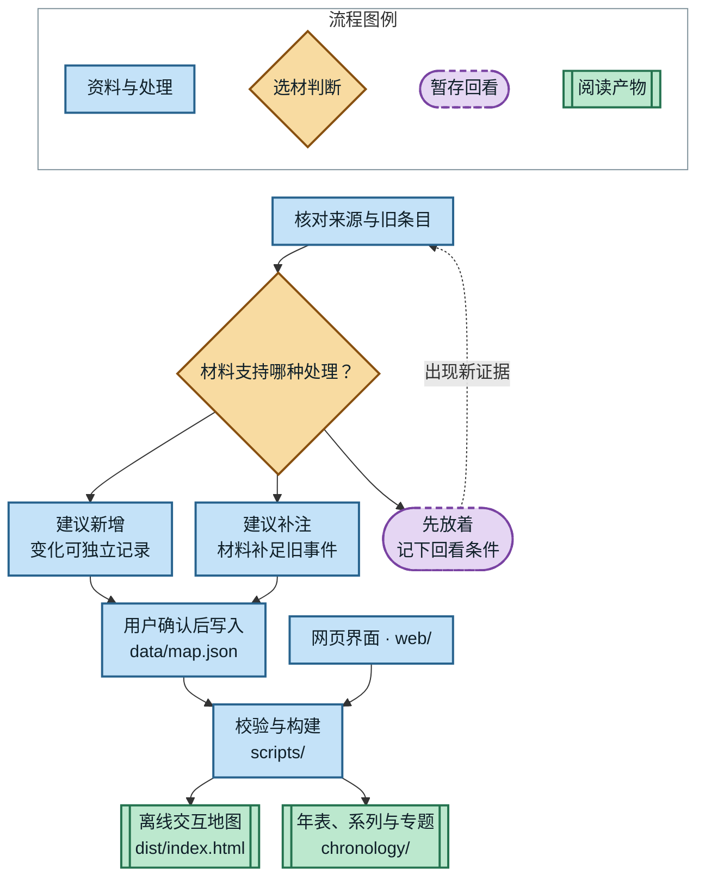

# 仍在生成 · AI 时代探索地图

《仍在生成》记录 2022 年以来人工智能怎样走进普通人的工作、创作和日常生活。你可以挑一个年份了解来龙去脉，跟着 GPT、DeepSeek 等模型系列看不同版本多了哪些用处，也可以直接从“做网站、对账能把哪一步交给 AI？”这样的实际问题读起。每条记录都附有日期和出处。

[在线地图](https://ai-growth-tracking.lastdanger-lab.workers.dev/) · [交互时间线](https://ai-growth-tracking.lastdanger-lab.workers.dev/#view=series) · [时间线文字版与两份试读档案](chronology/series/README.md#跨系列大事时间线) · [最近一期与年度年表](chronology/README.md)

## 先读一段 · 2026 年 9—11 月

**事件类型**　  　 **阅读状态**　

横读一行看同一系列怎么变，竖读一列比同月各家的动向。日期旁有淡紫色的「↺ 已有回看」时，点开事件名称可读截至观察日的后续。

| 系列 | 9 月 | 10 月 | 11 月，截至 23 日 |
|---|---|---|---|
| DeepSeek | <br>10 日 <br>[V4.1 Flash 可以接收图片](chronology/series/README.md#event-deepseek-v41-flash-release) | <br>17 日<br>[同一调用名换成新版](chronology/2026.md#event-deepseek-v41-flash-oct17) | <br>13 日<br>[文件与搜索接入 API](chronology/2026.md#event-deepseek-application-apis) |
| Kimi | | <br>23 日 <br>[K3.1 Pro 开放 API，首发评测可与前代对照](chronology/series/README.md#event-kimi-k31-pro-release) | |

打开地图的 **模型系列**，把观察日调到 **10 月 23 日**，点开 Kimi 看首发当天的判断。调到 **11 月 18 日**再点同一节点，看 GPT-6.2 和 Gemini 4 Neon 带来了哪些新选择。到 **11 月 20 日**，还可对照同价位的 API 和已能取得的 Kimi 权重。选 **11 月 23 日**再打开 DeepSeek 的 9 月节点，可读到腾讯拿 Hy4 flash 做办公任务成本对照的条件。

## 接下来怎么读

- **按年读时代。** 年度主线看能力、使用方式或产业结构的转折，分支补具体现场。可以从 2023 年的六站“破圈”开始，接着读 2024 年的交互扩展、2025 年的任务交接、2026 年的委托与边界。[年度入口](chronology/README.md)
- **按系列读发展。** 跨系列时间线把同月的选择放在一起。GPT、Claude、Gemini、DeepSeek、Qwen 和 GLM 各有一条跨年线，讲清同一系列的几次关键转折。[系列目录](chronology/series/README.md)
- **带着问题读。** 看做网站、对账和解数学难题各走到了哪一步，沿日期找出人还要做什么。想细看做网站，还可以单独比较设计图、待审代码和已发布的应用。[现在可以把哪些事交给 AI？](chronology/topics/what-can-i-delegate.md) · [图、代码，还是一个网址？](chronology/topics/website-deliverables.md)

## 一条线索怎样进入地图

说「看看最近有什么值得更新」，先得到一份短报。判断时看谁受影响、以前和现在差在哪里，以及材料能证明哪一步。能独立讲清的变化建议新增，给旧事件补上入口、实例或后续结果的建议补注。进入年度主线，还要解释它改变了这一年的哪段进程。[完整选材规则](PROJECT_RULES.md#近期选材)



多个入口共用同一事件档案。首发判断保留当天的依据，回看写明观察日、比较对象和适用条件。每隔几批连读标题，检查是否遗漏了真实用法、参与条件或公众反应。

## 本地试读与维护

在项目根目录执行，再用浏览器打开 `dist/index.html`。公开版由 Cloudflare 从公开仓库构建，本地试读和发布分别记录。

```powershell
node scripts/check.mjs
node --test scripts/check.test.mjs
node scripts/build.mjs
```

浏览内容统一维护在 [data/map.json](data/map.json)。年度覆盖、系列取舍和正文证据可沿档案追溯。研究收据与作者素材留在本地研究目录。

[项目简述](PROJECT_BRIEF.md) · [地图设计](docs/map-design.md) · [维护说明](docs/maintenance.md)
