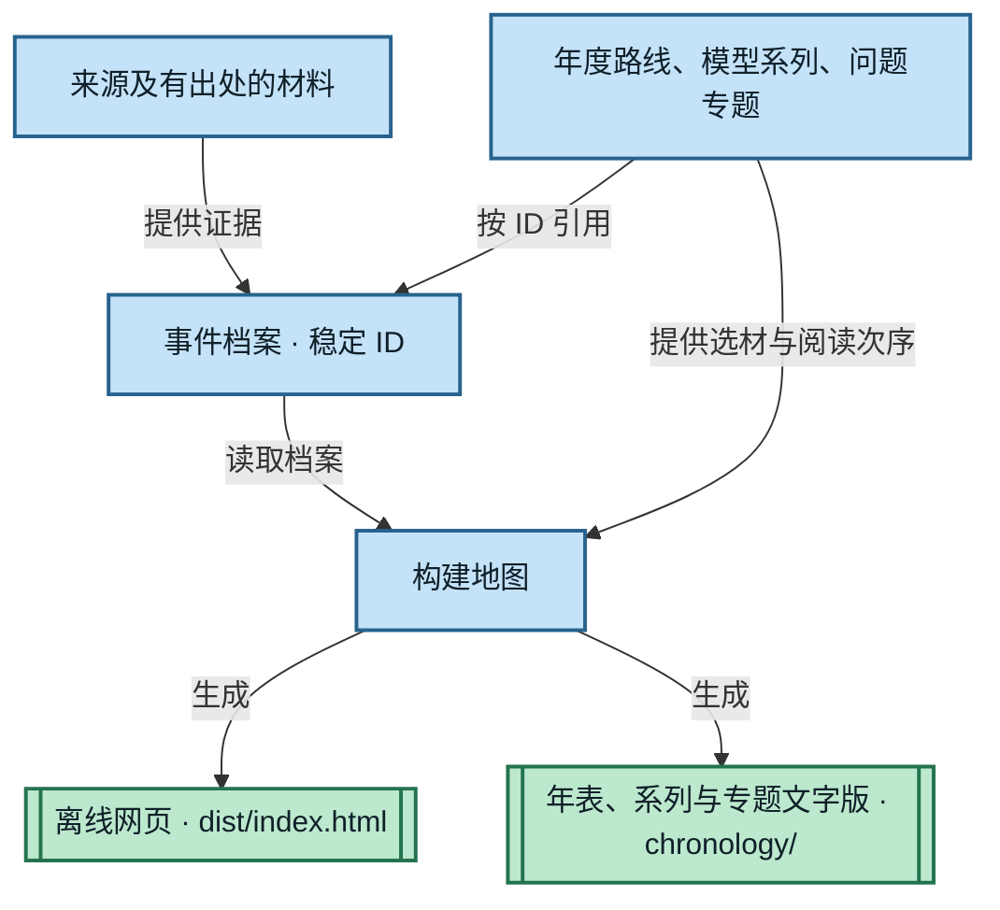

# AI 时代探索地图设计

> 开头说明现行设计，后半按日期保留演进过程。读者可以按年份、模型系列或手头的问题阅读同一份事件档案。首页的「最近一期」另列本期选材与截止日。当前覆盖见[项目入口](../README.md)。

## 浏览

首次到首页会看到三张入口卡。默认背景下，浅蓝日历表示年份，淡藤紫分支表示模型系列，米黄清单表示问题专题，打开后页头沿用入口颜色。杏色日期栏单列最近一期的选材截止日。选好入口或点「先自己逛」后，同一浏览器下次使用紧凑导航。三枚图标保留各自的底色，当前版块另有底色和下划线，页头的「地图指南」可重新展开。

页头的「背景」可以随时切换。初访默认「原版浅色」，偏好素净浅底也可选「浅绿留白」。「胡桃书页」用中等明度的胡桃棕衬奶油色正文，适合喜欢纸面读感的人。「深蓝夜读」把页头、时间线、事件卡、来源和表单都换成深蓝底浅字。夜读图例沿用原来的色相、符号和名称，并为深底调整明暗。选择记在当前浏览器，分享地址只保存阅读位置。

内页只在读者需要辨别或对照的地方用色。跨系列时间线用符号和短标签区分发布、更新与工具接入。档案里带日期的「↺ 后来再看」和后续材料的标签用紫色。问题专题用绿色标出「实际拿到什么」，杏色标出「人接下来做什么」。正文和出处跟随所选背景的纸面和字色，年度主线和分支靠缩进与连线辨认。比较模型能力时，写明日期、任务和依据。

从分享链接首次进入年份或档案时，就地提示怎样读。指南的开合保留当前地址和已展开的材料。年度页以年份与关键词开头，可展开年度导读与收录范围，再沿时间线读事件、分支和来源。

年度先显示少量主节点。事件分支须由编辑明确指定；仅时间相近的事件独立并列，不归入前一个主节点。具体改进方案见下文“阅读体验改进方案”。

「按问题读」目录（`#view=topics`）列出专题及任务线索。例如选“现在可以把哪些事交给 AI？”，就能从“用数据对账”打开事件，再回到原案例。系列目录的最近收录可直达该站。文字版沿用事件 ID 定位，按年份组织每个系列。

模型系列入口上方可横读一家、纵看同月。2026 年 9—11 月的试读选了五个家族，Kimi 与腾讯混元也可凭已有事件参与对照。观察日只筛这段时间线，按日期显示首发事实和当时已可读的回看。地址如 `#view=series&until=2026-10-23&event=kimi-k31-pro-release`，可直接回到该日的节点。

## 同一条事件怎样被读到

一条事件只有一个稳定 ID。年度路线、模型系列和问题专题各自挑选事件，写自己的转场、入选理由或任务说明。读者从不同入口点开它，看到的是同一份事件档案。图中蓝框表示资料与处理，绿色双框表示读者可以打开的成品。

## 内容数据

[data/map.json](../data/map.json) 是两种成品共用的内容源。当前 `schema_version` 为 3，`updated_at` 记录整包内容的更新日。下表说明改哪一处会影响读者看到的什么。[字段与引用校验](../scripts/check.mjs)

| 对象 | 何时改这里 | 数据约定 |
|---|---|---|
| `years` | 调整年度概括、代表事件或分组 | 必需。记下支撑事件、年度核验截止和覆盖限制。 |
| `events` | 记录变化或补充旧档案 | 必需。稳定 ID 供各入口引用，正文保留事件日期、入选理由、同期判断及出处。 |
| `sources`、`materials` | 登记出处，或选用其中一段材料 | 两个集合都必需。来源写发表日、查阅日和采用范围，每则材料指向具体来源。 |
| `relations` | 说明两个事件怎样关联 | 必需。记录两端 ID、关系方向和依据。 |
| `reading_routes`、`series` | 编排年度阅读路线或模型的跨年发展 | 两个集合都必需。路线选站并写转场，系列区分关键站与补充站，共用原事件。 |
| `series_timeline` | 把不同家族放回同一段时间比较 | 可选。每行引用已有事件，用观察日筛选节点和回看。 |
| `topics` | 回答一个能用实例对照的问题 | 可选。每个案例引用事件和出处，写明交付物、人的下一步和证据范围。 |
| `recent_update`、`site_intro` | 换首页最近一期，或调整站点介绍 | 均可选。最近一期有自己的选材截止日，首页精选取自当期事件。 |

`tier` 为 main / branch / root；`roles` 为 milestone / public-impact / early-signal。前者是阅读主次，后者是入选理由，不是一套热度分数。

`then` 是同期认识及材料，`later` 是带后续证据与截止日期的回看。没有证据就不填确定结论。

`date` 用于排序。`date_label` 是显示日期，`date_precision` 和 `date_basis` 标明粒度与发生、发布或报道性质。只有月份时，页面也只写到月份。

### 同一份 Kimi 档案的三个观察日

跨系列时间线引用的事件 ID 始终是 `kimi-k31-pro-release`。以下三行可以在同一份[试读档案](../chronology/series/README.md#event-kimi-k31-pro-release)对照。

| 观察日 | 当天在时间线里能读到什么 | 记录放在哪里 |
|---|---|---|
| 2026-10-23 | API 已开放。完整权重仍在预告中，可以依据首发评测比较前代。 | 事件的 `then` 和同期 `source_ids`。 |
| 2026-11-18 | 同一评测的候选中出现了新对手。两期同题、同设置的材料才足以量出差距变化。 | 事件引用材料 `M-kimi-nov18-choices`。其 `temporal_context` 为 `retrospective`，这条回看的日期取自来源的 `published_at`。 |
| 2026-11-20 | 已可取得完整权重。准备自行部署的人有了新选择，比较 API 的人也多了同价位参照。 | 事件的 `later` 写明判断、`as_of` 和 `source_ids`。 |

例如，把“完整权重已可下载”补进 10 月 23 日的 `then`，就会让首发当天的读者提前看到 11 月的消息。脚本能检查回看日期和来源 ID，编辑仍须读原文，判断材料能否支持这句话。观察日筛选用于跨系列时间线，系列目录文字版按该段时间线的选材截止日列出回看。

## 年份与关系

主体为 2022—2026，逐年深化。每年分别标注本轮选材已复核、种子资料或阶段观察；这些状态都不代表全年覆盖完整。少量前史根节点单独浏览，不硬设完整年度主题。

关系类型：uses（采用）、extends（延续）、follow-up（后续）、context（背景关联）。采用/延续的 from 为使用者或后续方法，to 为被采用或前序方法；follow-up 从前事件指向后事件。前两类需要直接证据；context 不表示因果，也不自动产生父子分组。没有明确归属的次级事件作为独立同期事件展示。

## 更新

选材并核来源 → 定主次与入选理由 → 补当时或后续证据 → 检查年度概括与锚点 → 校验并构建。新增新闻不自动晋升主线；年度关键句随证据修订。

网页只打包公开地图数据，内部研究与作者自述不得进入构建。

## 阅读体验改进方案 · 2026-09-30

已确认验收方向：“读者看完一段，能说清发生了什么变化、为什么重要，并知道下一步想点哪里。”本节保留2026-09-30的初始方案：A、B阶段完成后，依据一轮2023路线反馈进入C阶段，并在同日扩展2024—2026路线；后续编排以10-13串联修订为准。已有反馈支持继续试做，完整理解验收仍未完成。

### 目标与范围

“一段”指一条可以在约 5—8 分钟内读完的推荐路线，时间是控制篇幅的设计目标，需实际试读验证。它由少量现有事件构成，不恢复年度长文，也不要求读者打开所有来源才能理解基本变化。

保留年度时间轴、稳定事件 ID、主次层级、前史入口和原生 HTML/CSS/JavaScript。优先改善编排与正文，不把自由拖拽图谱、新框架、账号、自动采集或全站扩充作为前置。

### 页面如何组织

| 页面 | 默认看见 | 按需深入 |
|---|---|---|
| 年度总览 | 年份、关键词、关键句、一个明确指定的代表事件 | 展开这一年、进入代表事件 |
| 年度页 | 简短导读、一条推荐路线入口、按时间排列的主节点 | 事件自身的分支、独立同期事件 |
| 事件详情 | 具体现场或直述事实、发生的变化、意义与必要限制、推荐下一站 | 其他关系、完整来源、编辑入选说明 |

年度导读约 120—200 字，说明此前的处境、本年的主要变化和没有被关键词概括的差异。只补独有信息，不与现有 summary/tagline 重复显示。首次仅完善 2023；其他年度沿用已有概括。

年度首页代表事件改为显式指定，不按 public-impact 标签或材料数量自动选取。推荐入口与关键句的关系通过 featured_reason 说明；有趣的开场代表一种切面，不声称代表该年全部变化。本轮选定：2022 ChatGPT 首发、2023 公众增长、2024 Sora 展示、2025 DeepSeek 应用热潮、2026 OpenClaw。入口可随编辑判断修订，不自动改变主次。

推荐路线直接打开现有详情，不增加必须经过的中间页面。详情顶部显示路线名和进度，正文末尾给“下一站 + 为什么看它”；自由浏览、返回年度脉络始终可用。下一站来自人工编排，不能取 relations 数组的第一项。

### 三种联系分开表达

1. **本事件的细节或后续**：人工指定主节点与子事件，写清“具体用法”“产品后续”等关系。只在确实帮助理解该事件时缩进连线。
2. **主题上的并行事件**：在“相关探索”中说明共同问题，以平级链接展示；不因为同属模型或治理领域就画成父子。
3. **仅时间相近**：按月份进入独立的“同期其他事件”折叠组，与主节点同一层级，按日期穿插；不连到任何产品节点。日期顺序只负责定位，不解释因果。

取消 relations.find 的首条命中归组与按邻近主节点兜底的逻辑。展示归属与证据关系分开维护：内容审校先确认关系，再决定是否需要在主时间轴上挂接。已经合理的分组仍须显式登记，避免数组顺序改变页面结构。

例如文心一言、通义千问和 PaLM 2 可以帮助理解厂商竞逐，但不属于 Microsoft 365 Copilot 的产品分支；暂停训练公开信可在 GPT-4 的相关探索中解释共同背景，不能因为发生在三月就挂到 Copilot 下。上述编排判断不新增未经核验的因果结论。

### 事件正文与材料

正文保持自然段，不强制每个事件凑齐所有栏目。重点事件默认正文约 180—350 字，技术或产品小分支可更短；先保证理解，再控制篇幅。

- 有合适材料时，以一个有日期、有主体的具体场景开头：谁做了什么、遇到什么、说了什么。没有材料时直接交代事实，不虚构现场。
- 接着解释相对于此前发生了什么变化、影响了哪些人；区分演示、受邀试用、普遍开放和实际采用。
- 重要限定紧挨对应论断保留；长篇来源范围说明与“为什么入选”放到可展开区域，不让编辑说明压过事件本身。
- “后来再看”保留独立日期与证据，不混入同期现场。材料缺少发表日期时不默认标成“同期原话”。
- 具体说法就近挂来源标记，完整来源集中折叠；读者不点来源也能读懂叙述，点开后能追溯。
- 不把 summary 原样复制到 then。两者重复时重新分配摘要与正文职责；不能只通过隐藏一个栏目掩盖内容不足。

热潮材料优先呈现具体玩法、传播渠道及不同反应。每个重点事件优先挑一则有解释力的现场，确有不同视角再补第二则，不要求机械凑配额。“拳打谷歌”等短引必须带原报道日期、对象与上下文；只能说明该报道的语气，不能单独证明全网热度。网页继续以短引、文字说明和原文链接为基础，有合法可用的图片或视频且确实帮助理解时再增加，不用装饰图片代替证据。

### 首轮推荐路线：一个聊天窗口，为什么成了公共事件？

从 2023 年入口进入，回到 2022 年 11 月作为起点。跨年是明确显示的阅读安排，不移动事件的实际年份。以下六站为首轮编排，转场文字表达阅读问题，不宣称必然的历史因果。

| 站点与既有事件 | 希望读者理解 | 通向下一站的问题 |
|---|---|---|
| 1. ChatGPT 公开推出（chatgpt-public-preview） | 普通人获得了可以直接尝试的对话入口；具体能力和错误同时可见 | 从能试用，到受到广泛讨论，中间发生了什么？ |
| 2. ChatGPT 用户增长受到关注（chatgpt-public-growth） | 带口径的规模估算与同期用法共同解释传播；不只展示一个数字 | 关注度之外，接下来的能力展示改变了什么期待？ |
| 3. GPT-4 发布（gpt4-release） | 交代新增能力、当时实际开放范围，以及人们尝试的新用途 | 这些能力怎样被放进熟悉的工作工具？ |
| 4. Microsoft 365 Copilot 公布（m365-copilot-announcement） | 文档、表格与演示文稿成为产品场景；公告和实际采用有差别 | 演示以外，真实工作效果是否已有证据？ |
| 5. 客服现场研究（generative-ai-at-work-paper） | 特定样本测到效果，且不同经验人群差异明显；不能推广到所有工作 | 当 AI 进入工作，谁有权决定怎么用？ |
| 6. 编剧合同写入 AI 条款（wga-ai-contract-provisions） | 另一种劳动场景里，使用、署名和协商进入具体规则 | 结束该路线，可选择继续看创作热潮或开放生态 |

第 4→5 站须明确：这是另一项独立研究，不是 Copilot 的效果验证。第 5→6 站说明是不同职业的并行观察，不暗示客服研究促成编剧合同。路线结束给两句归纳，并明确它只观察公众入口与工作，不代表 2023 年全部主线。

这六站已存在，优先改写和重配现有材料。首轮查缺只围绕路线的解释需要，不按数量新增事件；若某站缺可靠材料，先缩小表述，必要时再定向补来源。模型竞逐、AI 翻唱、开放模型与算力等继续保留在年度浏览中，待首条路线验证后再考虑组织其他路线。

### 最小数据调整

仍以 data/map.json 为唯一公开内容来源。下表契约已随 schema_version 2 同步实现校验、构建和渲染；旧事件 ID、主次和关系保留。

| 位置 | 新字段 | 约束 |
|---|---|---|
| years | featured_event_id、featured_reason | 指向本年度事件，可为 main 或 branch；写清推荐理由，不自动改变事件主次 |
| years | lead、reading_route_id | 可选；lead 取代该页重复的长概括展示；2023—2026 路线已实现；2026 为阶段路线 |
| years | display_groups | 显式列 anchor_id 和 children（event_id、label）；仅登记需要挂接的分支 |
| 顶层 | reading_routes | id、title、focus、intro、steps、outro、exit_event_ids、exit_notes；出口说明包含 label 与 reason。可选 continuation（route_id、reason）只指向下一年路线；steps 保存 event_id、transition_to_next，可选 explore（event_id、reason）指向主路外已有事件，末站分支统一放出口 |
| events | change | 可选短说明，回答“相较此前改变了什么”；已用于四条路线，其他节点不空填模板 |
| materials | temporal_context | 区分 contemporary、retrospective、undated；结合来源发表日判断，不把抓取日当原作日期 |

路线不复制事件正文，来源继续由事件和材料登记。转场若包含新的事实判断，增加对应 source_ids；纯阅读提问无需虚构证据。display_groups 不创建新事实关系；children 只允许本年度 branch，每个分支最多有一个展示父节点，禁止自指和循环。跨年联系在路线或相关探索中呈现。

没有分配的 branch 自动进入独立同期组，不能消失；首次迁移逐条审阅现有 66 个 branch 的展示去向，重点修正 2023 年 13 个时间兜底节点。related 区仍可展示全部有证据的联系，但默认只露出少量最有阅读价值的链接，其余可展开。

保留原 year/event/view 深链；推荐路线只增加可选 route 参数。跨年下一站保留路线，主动跳出路线则退出路线状态；直接打开事件无须知道路线 ID。浏览器返回恢复来处、展开状态和阅读位置，关闭详情返回所选卡片。

### 视觉与阅读

当时沿用深色与薄荷绿基调、年度连续时间轴。视觉层级靠字号、留白、明确的连线和少量强调色建立。现行阅读背景见上文「浏览」。

详情正文先以 16px 左右及约 1.8 行高试排；桌面给详情更多可读宽度，必要时收窄背景时间轴；手机保持单列和完整正文。推荐下一站放在正文之后、扩展关系与完整来源之前，读者不必翻过长来源列表才能继续。首次优先验证阅读与返回，不增加新的必经页面或强制阅读顺序。

### 实施顺序与完成条件

| 阶段 | 交付 | 完成条件 |
|---|---|---|
| A. 修正全站基础 | 显式分组、独立同期组、年度代表入口；逐条清理 11 个通用理由和 24 个摘要重复项；同步过时状态文档 | 全部既有事件可达，主次不因迁移改变；无时间兜底父子关系；未精写节点仍如实显示现有内容 |
| B. 做通一条路线 | 六站正文与材料、2023 导读、转场与下一站、阅读排版 | 六站能连续读完，各站回答变化与意义，必要限制和来源仍可追溯 |
| C. 验证后推广 | 修正试读问题，再把有效模式应用到 2024 等年份 | 不凭代码测试宣布理解效果通过；按真实试读发现决定扩展范围 |

技术验收：node scripts/check.mjs、node scripts/build.mjs 与 JavaScript 语法检查；补充对分组重复/错年、无效路线引用、遗漏事件等规则的反例验证。浏览器覆盖首页、直接深链、完整六站跨年路线、跳出路线、浏览器返回、关闭详情回到卡片，以及桌面和手机的字体、焦点与溢出。生成网页和年表仍由同一数据构建。

内容验收：六站事实与现场核对来源；入选理由不得与 tier 冲突；读者视角逐站检查有没有解释“变化”和“为什么重要”，转场是否有具体阅读理由。链接可访问性与正文已读分别记录，不把 HTTP 成功视为内容核验。

理解验收：先请未参与编排的读者试读完整路线，读后用自己的话说出两个具体变化、至少一个受影响的人群或工作场景，并能说出想继续看的分支及原因。人数与反馈不足时记为试读样本，不宣布普遍有效；代理自审只能作为准备检查，不能代替真实试读。

实施记录进入现有总账。提交、推送和部署仍按用户针对该轮的授权执行；本方案的设计完成不等于代码、内容或理解验收完成。

### 2024 路线扩展（2026-09-30 记录）

按阶段 C 扩展下一年路线；扩展不代表普遍理解效果已获验证。

2024 路线题为“AI 走出聊天框之后，人还需要做什么？”，五站依次为 Sora 研究展示、Air Head 创作、GPT-4o 发布、AI Overviews 错误回应、Claude computer use 公测。每站分别解释生成、制作、交互、使用与行动中的变化及人的判断。Sora 到作品是同一工具的延伸，其余转场明确是并行场景，不暗示产品间的因果。

优先使用既有事件与来源，补入四则同期文字材料，保留发布演示与实际开放、厂商回应与独立证据的边界。主创采访日期仍未确认，按未定日期材料展示。科研和制度作为终点后的两个探索出口；开放模型、算力及其他年度事件仍在时间轴中，不为覆盖数量挤进路线。该五站版尚待用户试读。

### 2025 路线扩展（2026-09-30 记录）

用户授权发布 2024 版并继续下一步，按年度顺序扩展 2025。题为“说出想法以后，AI 能替人做到哪一步？”，沿 DeepSeek 公众试用、vibe coding、GitHub coding agent、METR 效率实验、ChatGPT agent 五站阅读。起点用应用榜单定位公众热潮，中段以具体使用和任务交接说明变化，独立实验检验效率期待，再走向资料与文件的综合任务。

这条路线偏重软件和资料工作，不替代年度全貌。DeepSeek 热潮不被写成其他工具诞生的原因；METR 研究不是对上一站 GitHub 产品的测评；ChatGPT agent 的发布也不被写成解决实验问题的结果。四月 MenuGen 自述仍是二月命名事件的后来材料。终点给图像创作与 MCP 共同治理两个出口，机器人、算力等继续在年度地图中探索。

本轮重用既有事件与材料，不增加节点数量。GitHub 原新闻稿跳转新闻首页，公开引用转向仍可读的同期官方文章；原登记保留历史核验说明。2025 路线技术验证通过，理解效果仍待真实试读。

### 2026 阶段路线（2026-09-30 五站初版，后由10-13三站版取代）

用户授权发布2025版并继续下一步，按年度顺序组织“让 AI 持续做事，边界放在哪里？”。五站为 Cowork 文件委托、OpenClaw 个人代理、METR 实验更新、ChatGPT Work 持续任务、Hugging Face 事件调查。前三站分别回答怎样交材料、怎样找到自己的代理，以及习惯变化为何不能直接换算成效率；后两站把持续跟进与授权边界放在一起读。

各站是阅读问题的接续，不是产品间的因果链。METR实验不是对前两站产品的测评；最后调查发生于内部研究环境，不能归因到上一站消费产品。调查公开日与事件发生日分开，公司的说明和独立调查范围分别交代。终点提供 AlphaGenome 和机器人半马两个出口，其他主题仍留在年度地图。

本轮重用五个节点和既有材料，定向复核八个来源；不增加事件，也不把年度覆盖截止从09-15推进到查阅日。该路线仍是进行中年份的阶段整理，技术验证通过，理解效果仍待真实试读。

### 2026-10-13 四条路线串联修订

本节取代上文扩展记录中的当前路线编排；历史记录保留。四年分别聚焦公众对话与工作规则、画面声音与操作、单项任务交付、持续工作。2023—2025 末站直接进入下一年推荐路线，入口说明阅读问题；其他出口标明换视角的理由。转场解释读者为什么继续，产品、研究对象和环境差异在相关位置简短保留。

2024 改题为“从生成画面到操作电脑，AI 怎样走出聊天框？”，五站保留。2026 收紧为 Cowork → OpenClaw → ChatGPT Work 三站；METR 更新放在 OpenClaw 的效果问题分支，调查作为终点的授权问题延伸，明确内部研究环境与消费产品的差异。事件本身、主次、来源与年度覆盖截止不变。通用事件正文不依赖“上一站”。

网页与生成的年表使用同一套转场、跨年和分支说明。新增引用、理由及跨年方向校验；真实理解效果仍待试读，不以浏览器检查替代。

### 开场材料选择（2026-10-13）

事件可选 scene_material_id，必须引用自身 material_ids 中的材料；未指定时沿用首则同期材料。明确选择允许展示主创访谈等日期未定材料，但原 temporal_context 标签必须保留，不能因被放到开头而变成同期证据。首段呈现具体场面或反差，事件正文交代发布与范围，change解释变化，避免三段反复讲同一组数字或开放限制。

### 分支来路与精选出口（2026-10-13）

从路线打开事件分支时，用from_route和from_event记录出发路线/站点；参数必须引用有效路线站点。连续探索保留最初来路，刷新和浏览器历史可恢复；明确返回、加入路线、切换年度、关闭或退出时清除。独立事件链接不会虚构来路。

事件可选reading_picks数组，每项为event_id、label、reason，最多三项、不得重复且必须已有事件关系。它控制相关探索的优先次序，原关系性质、范围与来源仍保留；未精选关系按原顺序继续展示或折叠。优先解释前因背景、后续进展或另一种选择，不为每个节点凑满三项。

页面与文字更新使用updated_at；年度资料覆盖核验采用各年as_of，两者分开显示。本轮补充历史材料不自动推进年度覆盖。

### 2026-10-28 年代地图与模型系列（首版实施记录）

年度地图仍为无参数默认首页；顶部并列“时代地图／模型系列”。系列目录展示 GPT、Claude、Gemini、DeepSeek、Qwen、GLM 六张卡片，分别给出厂商、阅读问题、最近收录进展及核验截止。“最近收录”不表示最新型号清单。各系列按年份刻度组织纵向时间线，关键站展开、补充条目折叠；使用现有详情面板，不复制正文、材料或来源，也不新增厂商页面。

当前契约升级为 schema_version 3。顶层 series 每项包含 id、name、provider、question、intro、as_of、coverage_note、entries；entries 每项为 event_id、level（key/supporting）、reason，非末关键站另有 transition_to_next。条目按事件 date、id 排序；禁止重复与失效引用。允许同一事件属于不同系列，但每处必须说明关联理由；关键站级别只控制系列阅读，与年度 tier 无关。

首版关键站数为 GPT 8、Claude 6、Gemini 5、DeepSeek 7、Qwen 5、GLM 5。GPT 纳入直接相关的 ChatGPT、推理与 Codex；Claude 纳入工作区、编程及 Cowork；Bard/PaLM 仅作 Gemini 前身；DeepSeek 区分基础模型、推理、热潮与 API；Qwen 区分应用、权重和许可；GLM 从 ChatGLM-6B 起点补到近期。Gemini 2025、Qwen 最新多模态和 GLM 外部使用材料仍有缺口，页面明示。跨厂商联系按证据说明背景或并行，不用厂商归属制造因果。

地址采用 #view=series、#series=gpt、#series=gpt&event=…；未知系列回目录。有效 series 优先于年度 route。系列成员跨年打开时保留系列；系列外关联用 from_series/from_event 保存来处，返回原站或关闭详情均可回系列。查看当年背景主动切到年度。历史、刷新恢复展开与滚动；关闭补充节点保留展开并把焦点还给卡片。旧年度、前史、事件及路线深链继续使用。

四条年度路线的19站顺序保持。本轮16个新增事件都列为年度分支，通过相关事件和系列入口进入；2026总览说明能力、成本及开放生态变化，关键词仍是“委托与边界”。截至10-28的核验是定向选材，不代表其他领域或所有版本完整更新。来源分别记录公告、可用、预览与权重状态；未来承诺不能写为已开放。生成的 chronology/series 与网页共用数据，内部研究不进入 dist。

技术验收与理解验收分开：契约、构建和浏览器导航检查验证本地可用；能否说清系列变化、意义及下一步仍需真实试读。该阶段仅本地实施，后续发布见同日发布记录。

### 2026-10-28 六系列选材与串联复审

本节更新上面的首版编排。GPT 8站聚焦公众入口、能力、开放与选择权：gpt-oss进入关键站，Terra转为近期补充，复用GPT-4o用户反馈。Claude 8站补Claude 3型号分工与Claude 4/Code正式可用；MCP替代宽泛的发布节奏政策进入生态分支，原政策事件仍在年度数据。Gemini 6站补2.5推理、Flash Image改图与3 Pro预览；搜索错误与Spark转为产品分支，复用Antigravity解释工作界面。

DeepSeek 7站用V3.1连接R1热潮和V4，10月服务更新作为补充。Qwen 7站补首次权重开放及Omni，重写2.5的专业分工与跨团队采用，避免连续两站只谈尺寸。GLM 5站用4.5解释推理、编程与工具组合，GLM-5论文降为方法分支。系列的变化不统一写成“最终成为代理”；每条保留不同的问题和参与者。

新增9个历史事件，默认关键站只净增5个（36→41）。共用事件补足变化与意义，所有关键站均有change；转场从泛泛提问改为“前一阶段已经做到什么、下一阶段还需解决什么”。少量前因直接交代，例如Codex在2026桌面应用之前已有2025云端任务；不为每个背景年份新增必经节点。每条说明保留其来源和日期身份。

清理23条将系列通用转场重复抄入relations的context边，阅读次序继续在series中维护。保留有事实意义的原关系，并对用户反馈、工具连接、跨团队采用与近期服务补充给出精选入口；关系总数从123降至108。四条年度路线站序、已有事件年度主次和各年截止保持。资料包仍截至10-28，本轮只补历史断点，不代表所有型号及独立使用反馈已经齐全。

### 2026-10-28 发布说明

双入口与六系列串联修订于2026-10-28获授权发布。上文“仅本地”描述此前实施阶段的边界。技术校验与构建通过，理解效果仍需真实试读；该次线上核验记录见项目总账。

### 2026-10-28 使用材料与系列收束

本轮不增加事件或关键站，四条年度路线保持。Qwen2.5与Qwen3补入后续部署测试、简单工具调用；GLM-4.5补入发布次日的本地使用自述；Gemini图像编辑补应用入口、个人设计玩法和平台社区回顾。首发、同期反应与带日期的后来材料分开，提供运行条件与来源身份，不复述排名或用单个作品推断普遍效果。系列文字视图同步输出已有材料及其时间身份。

schema v3内补充series.outro与series.exit（event_id、label、reason），结尾概括本系列变化并给一个非关键站探索出口。每个supporting条目须有return_to（本系列关键站event_id、reason）；返回按编辑解释选择，可回到较早关键站，不按最近日期猜测。关键条目继续使用transition_to_next，不混用补充返回。最后一个关键站显示总结；晚于它的补充事件仍显示自己的返回说明，不伪装成主线终点。

系列外事件沿用from_series/from_event记录真实来处，展示原站提出的探索问题，再返回原站；新增结尾出口也走相同导航。年度详情与系列详情仍共用事件正文、材料和来源。技术检查之外，仍需读者判断能否复述变化。该次修改先在本地完成，随后获授权发布。

发布记录：2026-10-28使用材料与系列收束修订完成发布，本地提交f20da8b、公开提交8fae466；当日构建与页面核验通过。这是该日收据，不表示后续本地修改自动获准发布，也不代替新的线上核验。
